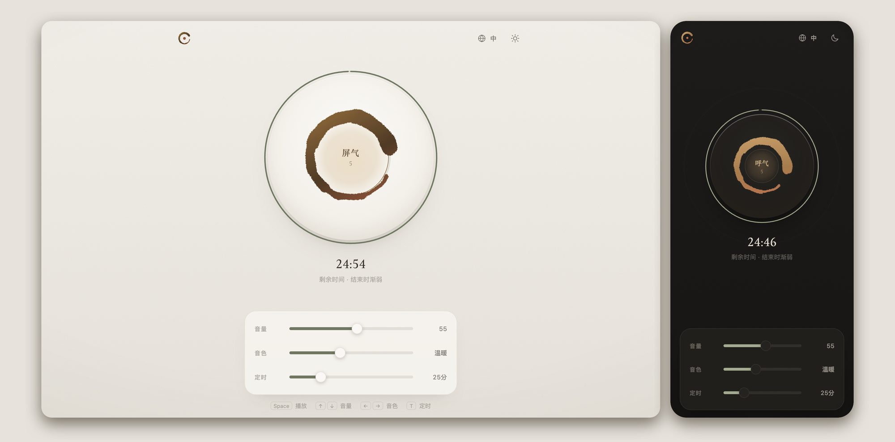

# 禅 · 棕噪音 · Zen Brown Noise

一个安静、极简的棕噪音网页应用，用来专注、放松和入睡。轻触圆相开始播放，跟着中间的光做 4-7-8 呼吸。

A quiet, minimalist brown noise web app for focus, rest and sleep — with a built-in 4-7-8 breathing guide. [English ↓](#english)

**在线体验：** [brownnoise.aiwayfarer.net](https://brownnoise.aiwayfarer.net)



## ✨ 功能

| | |
|---|---|
| **圆相播放器** | 中央的笔触圆相就是播放键。点击后圆相重新"书写"一遍，播放中缓慢旋转。 |
| **4-7-8 呼吸引导** | 圆心的光吸气 4 秒变大、屏气 7 秒保持、呼气 8 秒缩小。中间显示"吸气 / 屏气 / 呼气"和倒计时，换阶段时文字交叉淡化；每次呼气外圈扩散一圈涟漪。 |
| **音量与音色** | 音量采用符合听感的曲线；音色从"低沉"到"明亮"，由低通滤波实时调节。 |
| **定时** | 滑杆可选 5 分钟到 4 小时（含 25 分钟番茄钟），拖到最右边为 ∞ 不限时。剩余时间以圆环显示，结束时 8 秒渐弱停止。 |
| **多语言** | 默认中文，右上角 🌐 可切换 English、日本語、한국어。 |
| **浅色 / 深色** | 素雅的暖灰纸色与炭灰夜间主题；默认跟随系统，也可手动切换。 |
| **顺滑的声音** | 开始、暂停都有淡入淡出，无"啪"声；立体声无缝循环，没有周期性的咔哒声；暂停后挂起音频引擎，更省电。 |
| **系统集成** | 锁屏 / 耳机媒体控制，可添加到主屏幕作为 PWA 使用，离线可用。 |
| **记住设置** | 音量、音色、定时、语言、主题都保存在本地，下次打开即恢复。 |

## ⌨️ 快捷键

| 按键 | 作用 |
|---|---|
| `Space` / `K` | 播放 / 暂停 |
| `↑` `↓` | 音量 ±5 |
| `←` `→` | 音色 |
| `T` | 切换到下一个定时档位 |
| `D` | 切换浅色 / 深色 |
| `Esc` | 关闭语言菜单 |

焦点在某个滑杆上时，方向键只调节该滑杆。

## 🌬️ 为什么是棕噪音和 4-7-8？

- **棕噪音**的能量集中在低频，听起来像远处的瀑布或低沉的风声，比白噪音更柔和，很多人用它来屏蔽环境噪音、帮助专注或入睡。
- **4-7-8 呼吸法**：吸气 4 秒、屏气 7 秒、缓慢呼气 8 秒。较长的呼气有助于放松。初次练习如有头晕，请恢复自然呼吸。

> 本应用不是医疗产品，不能替代专业诊断或治疗。

## 🚀 本地运行

纯 HTML / CSS / JavaScript，无需构建、没有依赖。

```bash
git clone https://github.com/lima1217/zen-brown-noise.git
```

```bash
cd zen-brown-noise && python3 -m http.server 8000
```

然后打开 <http://localhost:8000>。直接双击 `index.html` 也能用，只是不会启用离线缓存（Service Worker）。

> 为便于开发，Service Worker 在 `localhost` 上不会注册，修改后刷新即可看到效果。

## 🗂️ 项目结构

```
index.html          页面结构（文本带 data-i18n 标记）
style.css           主题变量、布局与动画
app.js              音频引擎、呼吸引导、定时、快捷键、主题与语言切换
i18n.js             中 / 英 / 日 / 韩 界面文案
sw.js               Service Worker 离线缓存
manifest.json       PWA 配置
icon.svg            图标源文件（favicon.png、apple-touch-icon.png 由它导出）
preview.png         README 预览图
```

## 🛠️ 自定义

| 想改什么 | 在哪里 |
|---|---|
| 呼吸节奏 | `app.js` 顶部的 `BREATH_PHASES`（默认 4 / 7 / 8 秒） |
| 定时档位 | `app.js` 的 `TIMER_STEPS`（`0` 表示 ∞，需放在最后） |
| 颜色与主题 | `style.css` 顶部的 `:root` 变量；深色主题变量在 `[data-theme="dark"]` 和 `prefers-color-scheme` 两处，需同步修改 |
| 界面文案 / 新增语言 | `i18n.js`，并在 `index.html` 的语言菜单里加一项 |
| 音色范围、淡入淡出时长 | `app.js` 的 `toneToCutoff()`、`FADE_IN`、`FADE_OUT`、`TIMER_FADE_OUT` |

发布新版本时，请同时更新 `index.html` 里资源链接的 `?v=` 版本号，以及 `sw.js` 中的 `CACHE_NAME` 和缓存列表，确保已安装的用户能拿到新文件。

## 📱 小提示

- iPhone 上如果没有声音，请检查侧边的静音开关。
- 浏览器要求先点击一次才能播放声音，这是浏览器的限制。
- 添加到主屏幕后，可以像普通 App 一样全屏使用，也支持锁屏控制。

## 🔒 隐私

没有账号、没有统计、没有追踪。所有设置只保存在你浏览器的 `localStorage` 里；声音在本地实时生成，不下载任何音频文件。唯一的外部请求是 Google Fonts 字体。

## 📄 许可

[MIT](LICENSE) © 2026 lima

---

## English

**Zen Brown Noise** is a calm, single-screen brown noise player.

- **Tap the ensō** to play or pause. The noise is generated live with the Web Audio API, fades in and out smoothly, and loops seamlessly in stereo.
- **4-7-8 breathing guide**: the light in the center grows for 4s (inhale), holds for 7s, and shrinks for 8s (exhale), with a live cue and countdown.
- **Volume, tone and timer sliders**: tone runs from Deep to Bright. The timer goes from 5 min to 4 h, or slide all the way right for ∞; it fades out gently at the end.
- **Interface**: Chinese by default, plus English, Japanese and Korean. Light and dark themes. Works offline as a PWA and supports lock-screen media controls.
- **Shortcuts**: `Space` play/pause, `↑↓` volume, `←→` tone, `T` timer, `D` theme.

Run it locally with any static server (e.g. `python3 -m http.server`). No build step, no dependencies.

---

## 📋 更新日志 · Changelog

### v2.0.0 (2026-10-13)
**全新界面与交互 · Full redesign**
- 🎨 圆相播放键与圆相图标；素雅的暖灰纸色 / 炭灰深色主题，去掉了刺眼的彩色渐变
- 🌬️ 4-7-8 呼吸引导：可见的呼吸光盘、阶段文字交叉淡化与倒计时、呼气涟漪
- 🎛️ 新增音色调节；定时改为滑杆（5 分钟 – 4 小时 / ∞，含 25 分钟番茄钟），带进度圆环和渐弱结束
- 🌐 默认中文，可切换英 / 日 / 韩
- ⌨️ 键盘快捷键；所有设置本地记忆
- 🔊 淡入淡出、无缝立体声循环（修复每 10 秒一次的咔哒声）；暂停时挂起音频引擎
- 🖼️ 新的 favicon / 主屏幕图标（尺寸与 manifest 一致）和 SVG 图标

### v1.1.0 (2026-01-08)
**PWA & Mobile Enhancements**
- ✨ Added iOS home screen icon (`apple-touch-icon.png`)
- ✨ Added PWA meta tags for mobile web app support
- 🐛 Fixed: Audio now continues playing when switching browser tabs on desktop
- 🐛 Fixed: Touch gesture volume control now works on mobile devices
- 📱 Added `touchmove`, `touchend`, `touchcancel` event handlers for mobile

### v1.0.0 (2026-01-07)
**Initial Release**
- 🎨 Minimalist zen aesthetic with Green/Yellow/Blue color palette
- 🔊 Brown noise generation using Web Audio API
- 🖱️ Circular gesture volume control
- ✨ Breathing animation and visual feedback
